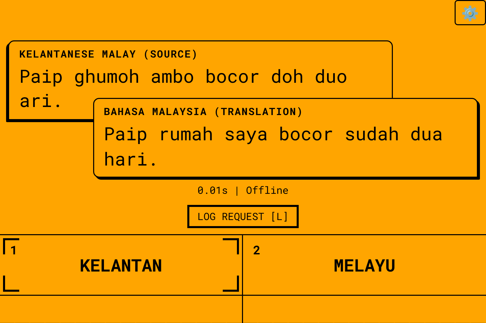
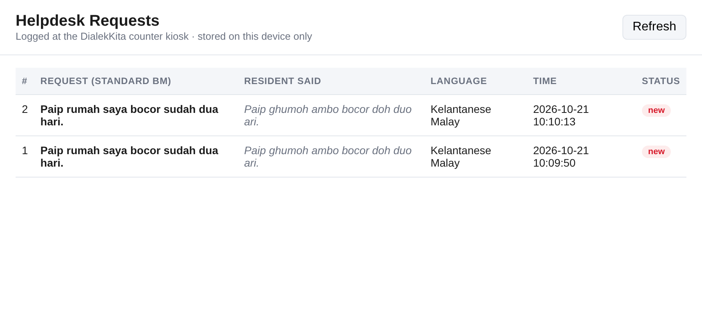

# DialekKita

**An offline AI translator that speaks how Malaysians actually speak.**
Built for the Sime Darby Property University Hackathon 2026 — *Township of Tomorrow*, People track.

A resident speaks Kelantanese, Northern, Sabah or Sarawak Malay, or Manglish, at a township service counter. DialekKita turns it into standard Bahasa Malaysia (or English, Chinese or Tamil) for the staff, and speaks the staff's reply back to the resident. Everything runs **on the device** — no internet, and no resident audio ever leaves the kiosk.



## What DialekKita adds to Gemma Translator

DialekKita is built on Google's open-source [Gemma Translator](https://github.com/google-gemma/gemma-translator) (Gemma 4 E2B on LiteRT-LM, Moonshine speech, React kiosk UI, Raspberry Pi 5). We added:

| Feature | What it does | Where |
|---|---|---|
| **Malaysian languages** | Bahasa Malaysia, Kelantanese, Northern, Sabah, Sarawak, Manglish, English, Chinese, Tamil | `frontend/src/dialect/languages.js` |
| **Dialect layer** | Per-dialect glossary + example pairs; Gemma first normalises the dialect to standard BM, then translates | `frontend/src/dialect/dialects.json` |
| **Malay speech-to-text** | Offline Whisper (faster-whisper) for Malay and Tamil — the base Moonshine models don't support them | `backend/server.py` |
| **Malay voice output** | Offline espeak-ng voices for Malay and Tamil | `backend/server.py` |
| **Type-to-text fallback** | Press **T** to type instead of speaking (noisy guardhouse, or when dialect speech recognition struggles) | `frontend/src/components/TypeBar.jsx` |
| **Helpdesk request log** | Press **L** to log an understood request as a ticket (text only, stored on the device). Staff view it at `/requests.html` | `backend/server.py`, `frontend/public/requests.html` |



## How it works

```
Mic (push-to-talk) ─► Speech-to-text ─► Dialect layer ─► Gemma 4 E2B ─► Voice + screen
                      Moonshine (en/zh)   glossary +        via LiteRT-LM   Moonshine / espeak-ng
                      Whisper  (ms/ta)    normalise to BM
                                                   └──► optional: log as helpdesk request
```

All steps run locally on a laptop or a Raspberry Pi 5 (8 GB).

## Quick start (laptop: Linux or macOS)

```bash
git clone https://github.com/thoughtdenham2005/DialekKita.git
cd DialekKita
git checkout dialekkita-prototype        # until this branch is merged into main

# System packages
sudo apt-get install -y espeak-ng ffmpeg   # macOS: brew install espeak-ng ffmpeg

chmod +x setup.sh download_model.sh start.sh deploy-pi.sh
./setup.sh            # Python venv + dependencies (incl. faster-whisper)
./download_model.sh   # Gemma 4 E2B (~2.6 GB) + Whisper model — needs internet once
cd frontend && npm install && cd ..
./start.sh            # then open http://localhost:5173
```

The staff helpdesk page is at `http://localhost:5173/requests.html` (dev) or `http://localhost:3000/requests.html` (prod).

**Raspberry Pi kiosk:** `./deploy-pi.sh` (see [docs/UPSTREAM_README.md](docs/UPSTREAM_README.md)).

## Controls

Default lanes for the demo: **Person 1 = Kelantan** (resident), **Person 2 = Melayu** (staff).

| Key | Action |
|---|---|
| **Z** (hold) | Talk as the active person; release to translate |
| **Space** | Switch active person |
| **← / →** | Change the active person's language |
| **T** | Type instead of speaking (Enter translate · Tab switch person · Esc close) |
| **L** | Log the last request to the helpdesk |
| **⚙️** | Settings (model endpoint, voice on/off, keyboard mode) |

## Settings

| Environment variable | Default | Purpose |
|---|---|---|
| `DIALEKKITA_WHISPER_MODEL` | `small` | Whisper size for Malay STT. Use `base` on a Pi for speed, `medium` on a laptop for accuracy. |

## Editing the dialects (no coding needed)

Open `frontend/src/dialect/dialects.json`. Each dialect has:
- `glossary`: `["dialect word", "standard BM"]` pairs
- `examples`: `["dialect sentence", "standard BM sentence"]` pairs

Add words or sentences and restart. **Native speakers should verify every entry** — the starter set is a first draft.

## Known limitations

- Whisper is trained mostly on standard Malay, so heavy dialect speech may be transcribed imperfectly. The dialect layer corrects much of this, and type-to-text is the fallback. Next step: fine-tune on consented recordings from residents.
- espeak-ng voices are robotic but intelligible. A natural Malay voice is on the roadmap.
- Response time depends on hardware. Measure it on your device before quoting numbers.

## Privacy

No audio is stored. The only thing saved is the text of a request when staff press **Log request** (`backend/data/requests.jsonl`, excluded from git). There are no network calls at run time.

## Team

Universiti Teknologi Malaysia (UTM) — see the pitch deck for team details.

## License

DialekKita additions: MIT (see [LICENSE](LICENSE)).
Based on Gemma Translator © 2026 Google LLC, Apache License 2.0 (see [LICENSE-APACHE-2.0](LICENSE-APACHE-2.0)); upstream files keep their original headers.
